

<picture>
  <source media="(prefers-color-scheme: dark)" srcset="assets/header-dark.svg" />
  <source media="(prefers-color-scheme: light)" srcset="assets/header-light.svg" />
  
</picture>

🎓 CSE Graduate, BRAC University &nbsp;•&nbsp; 📚 M.Sc. in ICT, BUET &nbsp;•&nbsp; 📍 Dhaka, Bangladesh

     

### 🚀 About Me
<picture>
  <source media="(prefers-color-scheme: dark)" srcset="assets/coding-dark.gif" />
  <source media="(prefers-color-scheme: light)" srcset="assets/coding-light.gif" />
  
</picture>

- 🎓 I completed my **B.Sc. in Computer Science and Engineering** at [BRAC University](https://www.bracu.ac.bd/) with a **CGPA of 3.95/4.00**, including **4.00/4.00 in all 28 CSE courses**, thesis included. I'm now doing my **M.Sc. in ICT** at [BUET](https://www.buet.ac.bd/).
- 💻 I build full-stack web apps for everyday problems: digital payments, house rentals, student planning and animal rescue.
- 🧬 My thesis used **machine learning on bacterial genomes** to predict antibiotic resistance straight from genome data, faster than lab tests. I led the five-member team, and we checked the model on data from an independent lab.
- 🧑‍🏫 Over 4 semesters as a student tutor for Java and Mathematics, I was assigned to **400+ students** and gave **100+** of them one-to-one help in the dedicated Student Tutor lab, so I enjoy explaining hard ideas simply.
- 🤝 I mentored **120+ new students** through their first three semesters and helped run events for **150+ teams** at the BRAC University Computer Club.
- 🌱 I'm currently exploring **advanced AI** and **network and system security**.
- 💬 Ask me about **Django, React, Node.js, SQL or machine learning**.

The strand in the banner: my thesis read bacterial genomes, and each coloured rung is one of my six web projects in its own colour.

### 🏆 Highlights

<picture>
  <source media="(prefers-color-scheme: dark)" srcset="assets/highlights-dark.svg" />
  <source media="(prefers-color-scheme: light)" srcset="assets/highlights-light.svg" />
  
</picture>

### 🎓 Education

<picture>
  <source media="(prefers-color-scheme: dark)" srcset="assets/education-dark.svg" />
  <source media="(prefers-color-scheme: light)" srcset="assets/education-light.svg" />
  
</picture>

### 🌟 Featured Projects

Click a card for the code. Six of them are live, so you can try them without installing anything.

<table>
<tr>
<td width="50%" valign="top">
<a href="https://github.com/FaiazPronoy/TakaLagbe"></a>
 <a href="https://takalagbe.site.je">Live demo</a> &nbsp;|&nbsp; <a href="https://github.com/FaiazPronoy/TakaLagbe">Source code</a>
</td>
<td width="50%" valign="top">
<a href="https://github.com/FaiazPronoy/Rentorium"></a>
 <a href="https://faiazpronoy.pythonanywhere.com">Live demo</a> &nbsp;|&nbsp; <a href="https://github.com/FaiazPronoy/Rentorium">Source code</a>
</td>
</tr>
<tr>
<td width="50%" valign="top">
<a href="https://github.com/FaiazPronoy/SafeBook"></a>
 <a href="https://fazpronoy.pythonanywhere.com">Live demo</a> &nbsp;|&nbsp; <a href="https://github.com/FaiazPronoy/SafeBook">Source code</a>
</td>
<td width="50%" valign="top">
<a href="https://github.com/FaiazPronoy/BRACU-Course-Compass">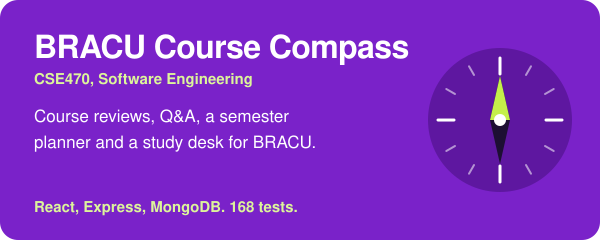</a>
 <a href="https://bracu-course-compass.onrender.com">Live demo</a> &nbsp;|&nbsp; <a href="https://github.com/FaiazPronoy/BRACU-Course-Compass">Source code</a>
</td>
</tr>
<tr>
<td width="50%" valign="top">
<a href="https://github.com/FaiazPronoy/Pother-Bondhu"></a>
 <a href="https://pother-bondhu.onrender.com">Live demo</a> &nbsp;|&nbsp; <a href="https://github.com/FaiazPronoy/Pother-Bondhu">Source code</a>
</td>
<td width="50%" valign="top">
<a href="https://github.com/FaiazPronoy/BRACU-CGPA-Analyzer">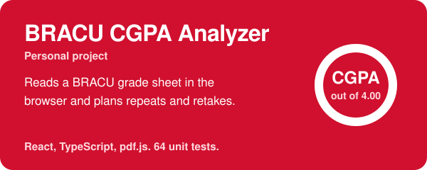</a>
 <a href="https://faiazpronoy.github.io/BRACU-CGPA-Analyzer/">Live demo</a> &nbsp;|&nbsp; <a href="https://github.com/FaiazPronoy/BRACU-CGPA-Analyzer">Source code</a>
</td>
</tr>
<tr>
<td width="50%" valign="top">
<a href="https://github.com/FaiazPronoy/Submarine_Saga"></a>
 <a href="https://github.com/FaiazPronoy/Submarine_Saga">Source code</a>
</td>
<td width="50%" valign="top">
 Details under Research below
</td>
</tr>
</table>

🔬 <b>Research and more projects</b> (click to expand)

 

- 🧬 **Lineage-Aware Antibiotic Resistance Prediction** (undergraduate thesis, A+): I led a five-member team to predict resistance to 7 antibiotics from the whole genomes of 6,962 E. coli isolates. Our TriLens-MoE-Stack model (three neural models, a mixture-of-experts gate and stacked learners) reached a mean PR-AUC of 84.9% against 83.0% and 80.3% baselines, and kept about 90% on 809 external samples. We also showed that random splits overstate results (63.4% on unseen lineages). Supervised by Prof. Dr. Md. Golam Rabiul Alam, with Prof. Dr. Swakkhar Shatabda and Md. Saiful Bari Siddiqui. *PyTorch, XGBoost*
- 💬 [**Textual Emotion Recognition**](https://github.com/FaiazPronoy/Textual-Emotion-Recognition) (CVIS Lab): five deep learning models and a fine-tuned RoBERTa, 93.3% test accuracy with a weighted vote. *TensorFlow, PyTorch, Transformers*
- 🏡 [**House Price Prediction**](https://github.com/FaiazPronoy/House_Price_Prediction) (CSE422 group project): 13 models and a stacked ensemble, R² 0.853 on unseen houses, with SHAP explanations. *Scikit-learn, XGBoost, SHAP*
- 🌱 **GreenSense** (CSE360): Arduino and ESP32 solar greenhouse that tracks eight conditions, with a Plant Health Score and a phone dashboard. *Arduino, C++*
- 💧 **Dual-Source Smart Irrigation** (CSE461): solar irrigation that uses rainwater first, then fish tank water, with Bluetooth and SMS control. *Arduino, C++*
- 🌐 **Enterprise Network Design** (CSE421) with VLSM and RIP, and an **x86 Assembly Banking Simulator** (CSE341).

### 🧑‍🏫 Teaching and Leadership

<picture>
  <source media="(prefers-color-scheme: dark)" srcset="assets/roles-dark.svg" />
  <source media="(prefers-color-scheme: light)" srcset="assets/roles-light.svg" />
  
</picture>

📌 <b>What I did in each role</b> (click to expand)

 

- 💻 **Student Tutor, Programming Language I (CSE110)**: selected as 1 of 65 tutors from 200+ applicants through a written exam (3.80+ CGPA required). Supported 150+ first-year students and taught Java fundamentals directly to 50+ in Student Tutor lab consultations, with pseudocode, code tracing and guiding questions.
- ➗ **Student Tutor, Mathematics I (MAT110)**: appointed on CGPA by the MNS Department and reappointed. Supported 250+ students, guided 50+ directly, graded assignments and prepared solutions.
- 🧭 **Student Mentor, First Year Advising Team**: mentored 3 cohorts of 40+ new students (120+ in total) through their first three semesters, with sessions on policies, exam strategy, probation and scholarships.
- 🎪 **Senior Executive, Event Management, BRAC University Computer Club**: promoted twice. Helped organise Bit Battles 2025 (150+ teams) and the Ada Lovelace Mindstorm ideathon (150+ participants).
- 🙋 **Student Volunteer**: 1 of 10 volunteers at CSE Research Day 2026, and served at two CSE Fresher Orientations.

### 🛠️ Skills
- **Languages:** Python, Java, JavaScript, TypeScript, C, PHP, SQL, plus data structures and algorithms practice on LeetCode
- **Web Development:** React, Tailwind CSS, Node.js, Express, Django, REST APIs, JWT
- **Databases:** MySQL, MongoDB, SQLite
- **Machine Learning:** PyTorch, TensorFlow (Keras), Scikit-learn, XGBoost, NLTK, Pandas, NumPy
- **Security and Testing:** AES, RSA, HMAC, bcrypt, access control, Vitest, Playwright, Django tests
- **Tools:** Git, GitHub, VS Code, Jupyter, Google Colab, Arduino
- **Practices:** OOP, MVC, SDLC, Agile
- **Operating Systems:** Windows and Linux
- **Spoken languages:** Bengali (native), English (professional)

 

  
  
  
  
  
  
  
  
  
  
  
  
  
  
  
  
  
  
  

📜 <b>Certifications and training</b> (click to expand)

 

- **Supervised Machine Learning: Regression and Classification**, DeepLearning.AI and Stanford Online, Aug 2025
- **Advanced Learning Algorithms**, DeepLearning.AI and Stanford Online, Aug 2025
- **Training on Development of ML/DL Models**, CVIS Lab, BRAC University, Summer 2025
- **GitHub Foundations**, Oct 2024, and **Git and GitHub 101**, Microsoft Learn Student Ambassadors, Sep 2024
- **Grameenphone Academy**: 18 short courses on AI and data skills in 2026, including GenAI and Prompt Engineering

### 🎯 Goals
- 🎓 Complete my M.Sc. in ICT at BUET with strong research in AI and security.
- 📝 Publish my thesis research on antibiotic resistance prediction in a reputable journal or conference.
- 💼 Grow as a software engineer in **fintech and AI**, building reliable and secure products.
- 🧩 Keep sharpening my problem solving on LeetCode and Codeforces.

### 📈 GitHub Stats

<picture>
  <source media="(prefers-color-scheme: dark)" srcset="https://raw.githubusercontent.com/FaiazPronoy/FaiazPronoy/output/stats-dark.svg" />
  <source media="(prefers-color-scheme: light)" srcset="https://raw.githubusercontent.com/FaiazPronoy/FaiazPronoy/output/stats.svg" />
  
</picture>
<picture>
  <source media="(prefers-color-scheme: dark)" srcset="https://raw.githubusercontent.com/FaiazPronoy/FaiazPronoy/output/top-langs-dark.svg" />
  <source media="(prefers-color-scheme: light)" srcset="https://raw.githubusercontent.com/FaiazPronoy/FaiazPronoy/output/top-langs.svg" />
  
</picture>

<picture>
  <source media="(prefers-color-scheme: dark)" srcset="https://raw.githubusercontent.com/FaiazPronoy/FaiazPronoy/output/snake-dark.svg" />
  <source media="(prefers-color-scheme: light)" srcset="https://raw.githubusercontent.com/FaiazPronoy/FaiazPronoy/output/snake.svg" />
  
</picture>

*"It always seems impossible until it's done."* 
Nelson Mandela

⭐ *Thanks for visiting! Feel free to explore my repositories.* ⭐

<picture>
  <source media="(prefers-color-scheme: dark)" srcset="assets/footer-dark.svg" />
  <source media="(prefers-color-scheme: light)" srcset="assets/footer-light.svg" />
  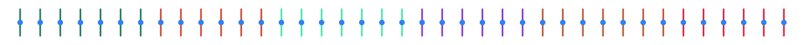
</picture>

